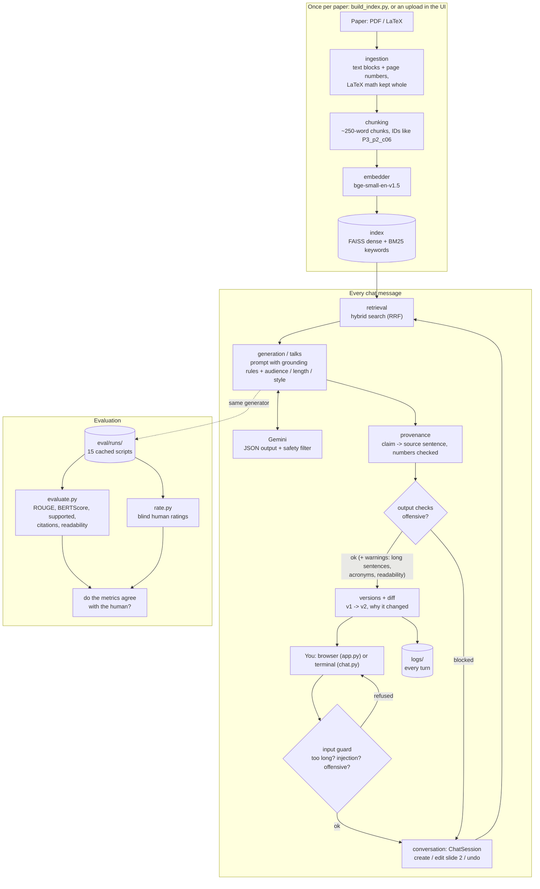

# "RAG Chatbot: Research Paper to Slides, Scripts & Summaries" 

A RAG (Retrieval-Augmented Generation) chatbot that takes a research paper (PDF/LaTeX) and generates
audience-adaptive slide bullets, speaker scripts and speaker notes, with a source citation on every
sentence and conversational editing ("make #2 less technical").

## Features

- **Ingest papers:** PDF/LaTeX parsing with page numbers; chunking that keeps LaTeX math blocks intact
- **Retrieval:** hybrid search, bge-small embeddings in FAISS + BM25 keywords, merged with Reciprocal Rank Fusion
- **Generation:** spoken scripts and slide talks (bullets, speaker notes, key equations in LaTeX), as
  validated JSON with automatic self-correction
- **Audience / length / style control:** policymakers, grad students, press · 30s / 90s / 5min / 7min ·
  technical, plain-English, press release
- **Provenance:** every generated sentence is linked to the source sentence, chunk and page that
  support it; numbers are checked exactly
- **Change tracking:** edits like "make #2 less technical" show old vs. new, why it changed, and
  whether the goal was met; undo; every turn is logged
- **Safety:** input guard (prompt injection, offensive words), Gemini's safety filter, offensive-output
  blocking, and accessibility warnings (long sentences, undefined acronyms, readability per audience)
- **Evaluation:** automatic (factuality proxy, citation coverage, ROUGE, BERTScore, retrieval
  ablation, audience adaptation) and human (blind ratings with a rubric)
- **Chat UI:** Streamlit, runs on localhost only, with paper upload

## Architecture



**One request, step by step:** the message passes the input guard → `ChatSession` works out what you
want → hybrid search finds the best chunks of the paper → Gemini writes the script or slides using
ONLY those chunks, citing their IDs → provenance checks every sentence against its cited chunk →
safety blocks harmful text and warns about hard-to-read text → the new version is saved, with a diff
against the old one, and the turn is logged.

## Project Structure

The code is organised as a pipeline. Each folder in `src/` is one stage, and each file in a stage
has one job:

```
paper.pdf ──► ingestion ──► chunking ──► retrieval ──► generation / talks ──► provenance
              (blocks)      (chunks)   (top-k chunks)  (script, slides)      (claim checks)
                                                              ▲
 browser (app.py, src/ui) ──► conversation (ChatSession) ─────┘   safety checks the message
 terminal (chat.py)       ──►   create / edit / undo              before and the text after
```

**Frontend vs backend:** `app.py` + `src/ui/` (Streamlit) and `chat.py` (terminal) only show things;
all the work is done by the backend in the other `src/` folders, through `ChatSession.handle(message)`.

```
Rag-chatbot/
├── src/
│   ├── config.py              # ALL settings: paths, model, chunk size...
│   ├── llm.py                 # the only file that calls the LLM (Gemini)
│   ├── ingestion/             # STAGE 1: paper file -> Blocks
│   │   ├── block.py           #   Block data type (prose / math + page + section)
│   │   ├── text_cleaning.py   #   fix ligatures, broken words, whitespace
│   │   ├── block_rules.py     #   is it noise / a heading / references / math?
│   │   ├── latex_math.py      #   protect LaTeX math from being split
│   │   ├── pdf_loader.py      #   PDF  -> Blocks
│   │   └── tex_loader.py      #   .tex -> Blocks
│   ├── chunking/              # STAGE 2: Blocks -> Chunks
│   │   ├── chunk.py           #   Chunk data type (ID like P3_p2_c06)
│   │   ├── sentences.py       #   math-safe sentence splitting
│   │   ├── chunker.py         #   size limit, page boundaries, overlap, IDs
│   │   └── storage.py         #   save / load chunks as JSON
│   ├── retrieval/             # STAGE 3: question -> most relevant Chunks
│   │   ├── retrieved_chunk.py #   RetrievedChunk data type (chunk + score + rank)
│   │   ├── embedder.py        #   text -> vectors (sentence-transformers, bge-small-en-v1.5)
│   │   ├── vector_store.py    #   DENSE search (FAISS, cosine similarity)
│   │   ├── bm25_index.py      #   SPARSE keyword search (BM25)
│   │   ├── hybrid.py          #   merge both rankings (Reciprocal Rank Fusion)
│   │   └── retriever.py       #   build / save / load index, retrieve()
│   ├── generation/            # STAGE 4: request + chunks -> script with [chunk ID] citations
│   │   ├── options.py         #   audience / length / style choices, ScriptRequest
│   │   ├── context.py         #   format chunks as the SOURCES block of the prompt
│   │   ├── prompts.py         #   prompt template family + grounding rules (system prompt)
│   │   ├── citations.py       #   find + check the [chunk IDs] in the answer
│   │   ├── script_result.py   #   GeneratedScript data type
│   │   ├── generator.py       #   ScriptGenerator: retrieve -> prompt -> LLM -> check
│   │   ├── source_selection.py #  abstract + top chunks + math-aware equation chunks
│   │   └── export.py          #   save a run as Markdown (examples/)
│   ├── talks/                 # STAGE 4b: structured slide talks (JSON via Pydantic schema)
│   │   ├── schema.py          #   Slide / Talk: the JSON shape Gemini must return
│   │   ├── request.py         #   TalkRequest: slides, notes per slide, focus, equations...
│   │   ├── prompts.py         #   talk template + self-correction retry prompt
│   │   ├── checks.py          #   slide count, notes, equations, length, citations
│   │   ├── result.py          #   GeneratedTalk data type
│   │   ├── generator.py       #   TalkGenerator: sources -> JSON -> check -> retry once
│   │   └── export.py          #   save a talk deck as Markdown
│   ├── provenance/            # STAGE 5: every claim -> the source sentence that supports it
│   │   ├── claim.py           #   split outputs into claims (sentence + cited IDs)
│   │   ├── numbers.py         #   EXACT match: numbers must appear in the cited source
│   │   ├── support.py         #   SEMANTIC match: best source sentence + verdict per claim
│   │   ├── report.py          #   metrics: citation coverage, supported share, number errors
│   │   └── export.py          #   Markdown provenance table + terminal summary
│   ├── conversation/          # STAGE 6: chat - create, edit (#2 less technical), undo, with change tracking
│       ├── commands.py        #   understand a message (fast path + Gemini structured output)
│       ├── edit_prompts.py    #   DELTA-ANCHORED edit prompts (only the changed part + its sources)
│       ├── editing.py         #   Editor: edit a slide / the script / the whole talk -> new talk + reason
│       ├── goals.py           #   measurable goal per request (simpler -> readability up, 90s -> 225 words)
│       ├── diff.py            #   the delta: field by field, word by word (~~old~~ **new**)
│       ├── readability.py     #   Flesch reading ease
│       ├── versions.py        #   versions + changes + before/after metrics, undo
│       ├── formatting.py      #   Markdown chat replies
│       ├── log.py             #   logs/session_*.json + .md (evidence of iteration)
│   │   └── session.py         #   ChatSession.handle(message) -> reply
│   ├── safety/                # STAGE 7: safety layers around the LLM
│   │   ├── offensive.py       #   offensive words (word list, minus research words + the paper's own words)
│   │   ├── inclusive.py       #   exclusionary words -> inclusive alternatives ("blacklist" -> "blocklist")
│   │   ├── injection.py       #   prompt injection ("ignore previous instructions") in messages / papers
│   │   ├── accessibility.py   #   long sentences, undefined acronyms, readability floor per audience
│   │   ├── input_guard.py     #   check_message(): refuse BEFORE calling the LLM
│   │   └── report.py          #   check_output(): offensive -> blocked, the rest -> warnings
│   ├── evaluation/            # STAGE 8: automatic evaluation (many scripts -> numbers)
│   │   ├── cases.py           #   what to run: papers x search modes x audiences
│   │   ├── references.py      #   human-written reference scripts (data/references/)
│   │   ├── overlap.py         #   ROUGE-1/2/L: shared words with the reference
│   │   ├── semantic.py        #   BERTScore: shared meaning with the reference
│   │   ├── row.py             #   EvalRow: every metric of one script
│   │   ├── runner.py          #   Evaluator: generate (cached in eval/runs/) -> measure
│   │   ├── summary.py         #   experiment tables: per search mode / per audience
│   │   └── export.py          #   eval/results.md + results.json
│   ├── human_eval/            # STAGE 9: human evaluation (people rate the cached scripts, blind)
│   │   ├── rubric.py          #   the questions + what every score means
│   │   ├── items.py           #   what to rate: 15 scripts + doubted sentences (+ controls) -> items.json
│   │   ├── ratings.py         #   one rater's answers: eval/human/ratings_<rater>.json
│   │   ├── session.py         #   the blind, resumable rating loop in the terminal
│   │   ├── analysis.py        #   means, majority labels, true share vs checker, agreement, correlations
│   │   └── export.py          #   eval/human/results.md
│   ├── upload.py              # add an uploaded paper: save -> ingest -> chunk -> scan -> index
│   └── ui/                    # FRONTEND: the Streamlit chat page (shows things, decides nothing)
│       ├── state.py           #   shared retriever (cache_resource) + one ChatSession per tab
│       ├── sidebar.py         #   upload, paper list, examples, downloads, new conversation
│       └── chat_view.py       #   the conversation + message box
├── tests/                     # one test file per stage (pytest)
├── data/
│   ├── papers/                # input papers
│   ├── chunks/                # output of chunking (JSON)
│   ├── uploads/               # papers uploaded in the UI (git-ignored)
│   └── references/            # human-written reference scripts (for evaluation)
├── hello_llm.py               # Day 1 check: can we call the LLM?
├── chunk_papers.py            # Day 2: run ingestion + chunking on all papers
├── build_index.py             # Day 3: embed all chunks, save index/ (git-ignored)
├── search.py                  # Day 3: python search.py "question" [--paper P3] [--compare]
├── generate.py                # Day 4: python generate.py --paper P3 --audience policymakers --length 90s
├── make_talk.py               # Day 5: python make_talk.py --paper P3 --slides 7 --notes 3 --focus methods
├── chat.py                    # Day 7: python chat.py  (or --demo for a scripted conversation)
├── app.py                     # Day 8: streamlit run app.py  (the chat UI in the browser)
├── evaluate.py                # Day 9: python evaluate.py  (-> eval/results.md)
├── rate.py                    # Day 10: python rate.py --rater <name>  (-> eval/human/results.md)
├── eval/                      # evaluation results + runs/ (every generated script, cached) + human/
├── .streamlit/config.toml     # UI settings: no usage statistics, 20 MB upload limit
├── logs/                      # conversation logs
├── examples/                  # saved example runs (input -> script -> sources -> checks)
└── NOTES.md                   # learning journal
```

## Setup

```bash
python -m venv venv
venv\Scripts\activate          # Windows
pip install -r requirements.txt
```

Copy `.env.example` to `.env` and paste your Gemini API key (free at https://aistudio.google.com/apikey).
`.env` is git-ignored, so the key never reaches GitHub:

```
GEMINI_API_KEY=your_key_here
```

Then build the search index once (`python build_index.py`) and run the tests (`pytest`, offline, no key needed).

## Usage

```bash
python build_index.py          # once: build the search index for data/papers/
streamlit run app.py           # chat UI at http://localhost:8501
python evaluate.py             # automatic evaluation -> eval/results.md (--out NAME: separate experiment)
python rate.py --rater <name>  # human evaluation (blind, resumable) -> eval/human/results.md
python chat.py                 # or chat in the terminal
```

Upload a paper (or use the 3 included ones), then chat, e.g.:

- "Make a 90-second script for policymakers"
- "Make a 7-slide talk for graduate students focusing on methods; include 3 speaker notes per slide"
- "Make #2 less technical"

## Evaluation

`python evaluate.py` generates 15 scripts (3 papers × 5 settings, 90 seconds each) and scores them.
Every script is cached in `eval/runs/`, so re-scoring needs no LLM calls. Full tables, every script, and
the meaning of each column are in [eval/results.md](eval/results.md).

**Retrieval ablation** (same request, only the search changes; policymakers, plain English):

| search | supported | grounded | cited | ROUGE-L | BERTScore |
|---|---|---|---|---|---|
| dense only | 65% | 88% | 97% | 0.167 | 0.392 |
| BM25 only | 64% | 91% | 91% | 0.160 | 0.376 |
| **hybrid** (used) | **73%** | 88% | 91% | 0.166 | 0.375 |

**Audience adaptation** (hybrid search):

| audience | supported | grounded | readability | BERTScore vs human script |
|---|---|---|---|---|
| grad students (technical) | 87% | 100% | 32 | 0.309 |
| policymakers (plain English) | 73% | 88% | 42 | 0.375 |
| press (press release) | 39% | 86% | 41 | 0.423 |

**Findings**
- **0 number errors and 0 invented citations in all 15 scripts.**
- **Hybrid search** had the most strictly supported claims, but the lenient "grounded" share is
  equal for all three, so with 3 papers × 1 run the advantage is suggestive, not proven.
- **Audiences really differ:** technical scripts stay closest to the paper's wording (most supported),
  and plain scripts are closest to the human-written references (higher BERTScore).
- **Found and fixed by the evaluation:** press releases were the *hardest* scripts to read (Flesch 28,
  below the grad-student scripts). After a prompt fix: 41. The cost was fewer strictly supported claims
  (74% → 39%; grounded 96% → 86%). Checking those claims by hand showed most were true paraphrases
  scoring just below the 0.80 threshold, but some were real press-release hype ("without losing their
  smarts"). Before/after: [eval/results_before_press_fix.md](eval/results_before_press_fix.md).
- All scripts came out 10–20% **shorter** than the 225-word target. **Fixed later (Day 11)**, see below.

**Length fix** (same 15 cases; `python evaluate.py --out length_retry`, results in
[eval/length_retry/results.md](eval/length_retry/results.md)):

| prompt | avg words (target 225) | in range 203–248 | length error | supported | grounded |
|---|---|---|---|---|---|
| "about 225 words" (Day 9) | 200 | 4 / 15 | 12.4% | 66% | 91% |
| range + "citations don't count as words" | 215 | 9 / 15 | 10.5% | 66% | 87% |
| **+ word count in code, 1 retry if outside** (used) | **229** | **13 / 15** | **6.5%** | 68% | 88% |

The model seemed to count `[P1_p2_c01]` citations as words, but nobody reads them aloud. Prompt
wording alone only half-fixed it, so the generator now counts the spoken words itself and retries
once with the real count (6 of 15 scripts needed it). Grounding did not drop. The other tables above
and the human ratings use the Day 9 scripts.

**Limits:** 3 papers, one run per setting, and one LLM, so small differences are noise. "Supported" is
an embedding-similarity *proxy* for truth (it measures closeness of wording, not correctness), and the
human references were written for a general audience.

### Human evaluation

`python rate.py --rater <name>` shows the same 15 cached scripts to a person, **blind**: they see the
audience but not the search mode, the metrics or the checker's verdicts. Each script gets 1-5 for
**factuality**, **audience fit** and **helpfulness**, using a written rubric. Then every sentence the
checker doubted (weak / unsupported / uncited), plus one supported sentence per script as a control,
gets a label: **true / hype / wrong / not a claim**. Answers are saved after every item, and each rater
gets their own file and their own random order.

The report ([eval/human/results.md](eval/human/results.md)) answers:
- How many claims are **really** true, compared with "supported" (strict) and "grounded" (lenient)?
- Do the automatic metrics rank the scripts the way a human does (Spearman correlation)?
- Do the raters agree with each other?

**Results** (1 rater, 15 scripts, 69 sentences: 63 labelled, 6 skipped)

| audience | factuality | audience fit | helpfulness |
|---|---|---|---|
| grad students | 5.0 | 4.7 | 4.3 |
| policymakers | 4.3 | 4.7 | 4.7 |
| press | 4.3 | 4.0 | 5.0 |

| checker verdict | n | true | partly / hype | wrong | not a claim |
|---|---|---|---|---|---|
| supported (control) | 13 | 54% | 31% | **0%** | 15% |
| weak | 36 | 56% | 28% | 11% | 6% |
| unsupported | 6 | 50% | 17% | 33% | 0% |
| uncited | 8 | 100% | 0% | 0% | 0% |

- **The scripts were rated highly:** every script scored 4 or 5 for factuality, and 14 of 15 scored 4+
  for helpfulness.
- **The checker caught every wrong sentence.** All 6 sentences rated wrong had been flagged as weak or
  unsupported, and none of the supported controls was wrong. 4 of the 6 were in press releases
  ("shrink massive models without losing their smarts"), which confirms the Day 9 suspicion.
- **But "supported" ≠ "exactly right":** 31% of the supported controls were rated partly right or
  hype. Embedding similarity sees the topic, not the tone or a small overstatement.
- **The "weak" band is mostly fine:** 56% were true and only 11% wrong. So "supported" (strict) is
  too harsh and "grounded" (lenient) is too kind; the truth is in between.
- **No automatic metric clearly agreed with the human scores** (Spearman: ROUGE-L +0.46 with
  helpfulness, p = 0.08; supported +0.38 with factuality; BERTScore ≈ 0). The factuality scores were
  only 4s and 5s, so there was little to rank, and n = 15.

**Limits:** one rater (the task asks for more; agreement could not be measured), who also built the
system, so the ratings may be biased. Some labels are inconsistent (e.g. "The results are striking"
rated true; "The sources do not mention…" rated true instead of "not a claim"), which is exactly
what a second rater and a calibration round would catch. Full report:
[eval/human/results.md](eval/human/results.md).

## References

**Method**
- Lewis et al., *Retrieval-Augmented Generation for Knowledge-Intensive NLP Tasks*, NeurIPS 2020. https://arxiv.org/abs/2005.11401
- Robertson & Zaragoza, *The Probabilistic Relevance Framework: BM25 and Beyond*, 2009 (BM25)
- Cormack, Clarke & Büttcher, *Reciprocal Rank Fusion outperforms Condorcet and individual Rank Learning Methods*, SIGIR 2009 (RRF)
- Lin, *ROUGE: A Package for Automatic Evaluation of Summaries*, 2004
- Zhang et al., *BERTScore: Evaluating Text Generation with BERT*, ICLR 2020
- Flesch, *A New Readability Yardstick*, 1948 (reading ease)

**Test papers** (in `data/papers/`)
- P1: Kim, *Convolutional Neural Networks for Sentence Classification*, EMNLP 2014
- P2: Joulin et al., *Bag of Tricks for Efficient Text Classification*, EACL 2017
- P3: Hinton, Vinyals & Dean, *Distilling the Knowledge in a Neural Network*, 2015

**Models**
- Gemini `gemini-flash-lite-latest` (Google), via the `google-genai` SDK: generation
- `BAAI/bge-small-en-v1.5`: embeddings for retrieval and provenance
- `distilbert-base-uncased`: BERTScore

**Libraries:** PyMuPDF (PDF parsing), sentence-transformers, FAISS, rank-bm25, Pydantic, textstat,
better-profanity, rouge-score, bert-score, SciPy, Streamlit, python-dotenv, pytest. See `requirements.txt`.
